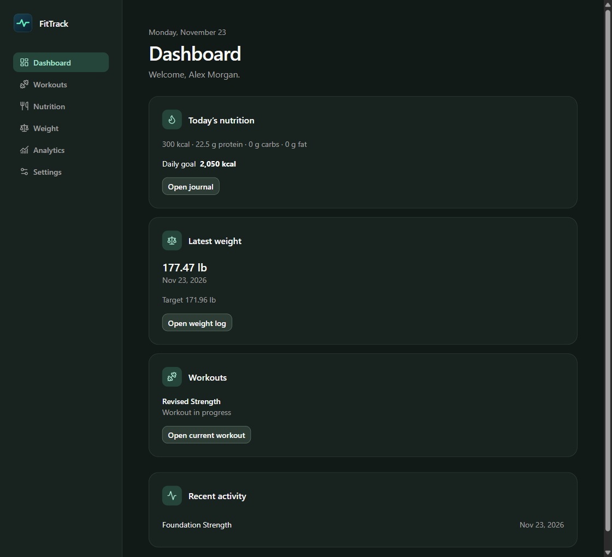
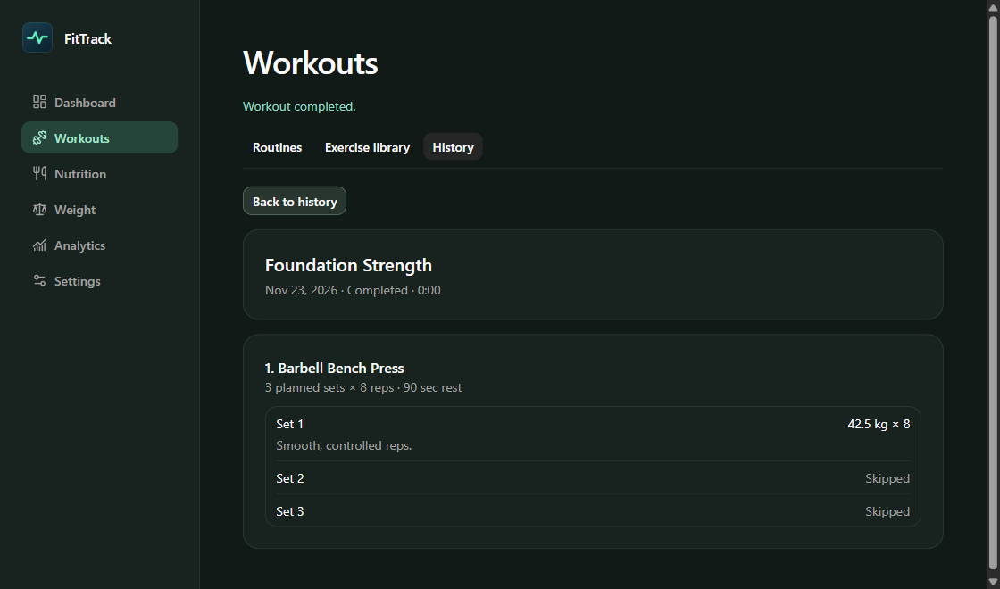
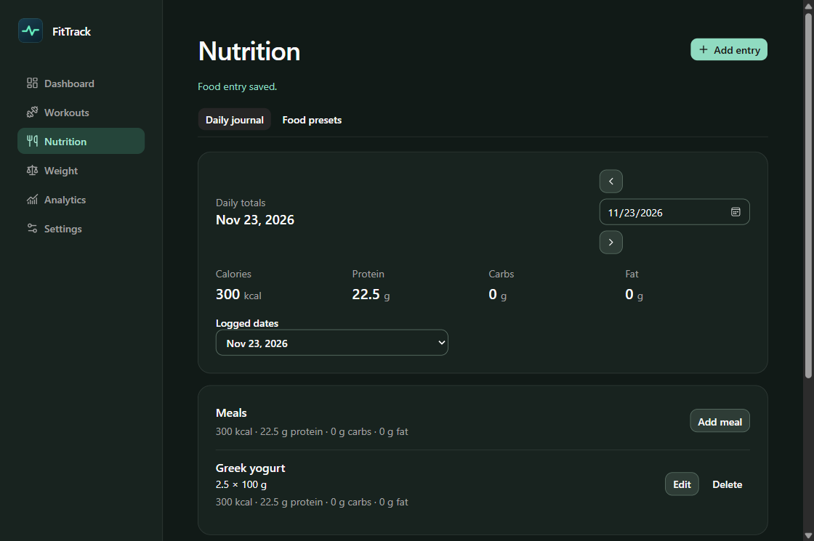
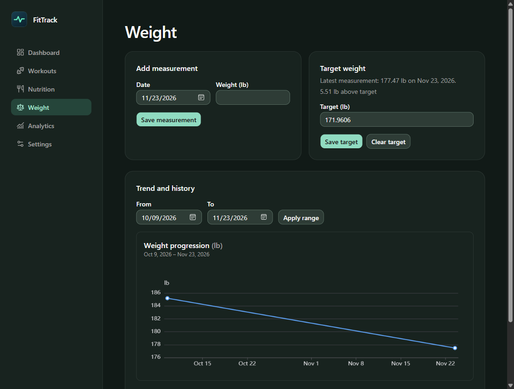

# FitTrack

FitTrack is a local desktop fitness tracker for workouts, nutrition, and body weight, with a dashboard and analytics.

## Screenshots

FitTrack running on Windows in dark mode with sample data.

| Dashboard | Workout history |
| --- | --- |
| [](docs/screenshots/dashboard.png) | [](docs/screenshots/workout.png) |

| Nutrition journal | Weight tracking |
| --- | --- |
| [](docs/screenshots/nutrition.png) | [](docs/screenshots/weight.png) |

## Tracking

- **Workouts** — Build a routine from the exercise library or add custom exercises. Set the exercise order, planned sets, reps, and rest, then start a workout. Select **Log set** to record a finished set and start its rest timer. Select **Save draft** to keep an incomplete set. Pause and reopen FitTrack to resume from the saved state. Completed sessions keep the routine plan they started with.
- **Nutrition** — Choose a journal date and add a meal, snack, or drink. Enter nutrients for one serving and the number of servings consumed. Daily totals include all three categories. Save food presets for reuse across dates. Editing a preset applies to future logs. Edit an existing entry from its journal date to correct the original record.
- **Weight** — Log a dated measurement, correct or delete it from history, and set a target weight. Select a date range to review the trend. Changing kilograms or pounds in Settings updates the display and entry unit.
- **Analytics** — Select a date range and group totals by day, Monday-start week, or calendar month. Compare calories and macros, body weight, workout frequency and active time, and exercise progression. Training volume sums load × reps for logged weighted sets in completed workouts. Personal records use the selected date range.

## Development

Install Go 1.26 or newer, Node.js 24 or 26, Bun 1.4.5, and the native dependencies for your Wails platform. Install the Wails v3.1.0 CLI and make it available on your `PATH`.

```sh
go install github.com/wailsapp/wails/v3/cmd/wails3@v3.1.0
wails3 doctor
wails3 dev
```

Wails runs Vite on loopback in development and embeds `frontend/dist` in the production binary. `wails3 build` runs the platform build and puts the executable in `bin/`. The frontend dependencies are pinned in `frontend/bun.lock`.

## Checks

Run `wails3 build` before the Go checks so the embedded frontend exists.

```sh
wails3 build
go test . ./internal/...
go vet . ./internal/...
cd frontend
bun run format:check
bun run lint
bun run typecheck
bun run test
```

On Windows, build the smoke executable after `wails3 build` so it uses the production frontend. The smoke tag enables the loopback test connection and blocks external WebView traffic. The test uses a temporary user data directory to verify settings, workout recovery and history, dated nutrition snapshots, weight persistence and unit changes, and analytics charts through the desktop UI.

```powershell
go build -tags 'production,fittrack_smoke' -o bin/fittrack-smoke.exe .
node scripts/smoke-windows.mjs
```

## Local data

**Settings → Data and recovery** shows the database and backup locations. You can export and import CSV or JSON, create a SQLite backup, and restore a validated backup.

See the [documentation index](docs/README.md) for installation, data recovery, architecture, and releases.

## Credits

- FitTrack started from [Wails Vue Tailwind TypeScript](https://github.com/vanam-san/wails-template-vue-tailwind) v1.1.0.
- James Gay’s [FitNotes](https://play.google.com/store/apps/details?id=com.github.jamesgay.fitnotes) inspired the workout calendar, history navigation, and quick exercise entry.
- The desktop app uses [Wails](https://wails.io/) and [Go](https://go.dev/). Local storage uses [SQLite](https://sqlite.org/), [modernc.org/sqlite](https://pkg.go.dev/modernc.org/sqlite), and [sqlc](https://sqlc.dev/).
- The interface uses [Vue](https://vuejs.org/), [TypeScript](https://www.typescriptlang.org/), [Vite](https://vite.dev/), [Tailwind CSS](https://tailwindcss.com/), [shadcn-vue](https://www.shadcn-vue.com/), [Lucide](https://lucide.dev/), and [Apache ECharts](https://echarts.apache.org/). [Bun](https://bun.sh/) manages frontend dependencies and [Vitest](https://vitest.dev/) runs frontend tests.

## Contributing and license

See [Contributing](CONTRIBUTING.md) and the [Code of Conduct](CODE_OF_CONDUCT.md). FitTrack is distributed under the [MIT License](LICENSE), which includes the starter’s copyright notice.
