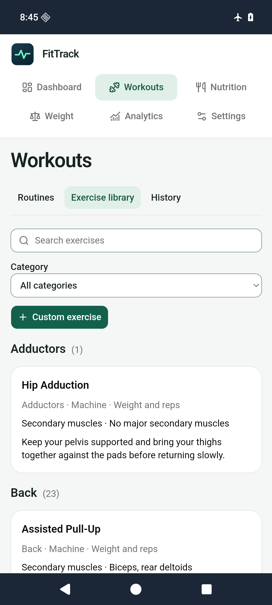
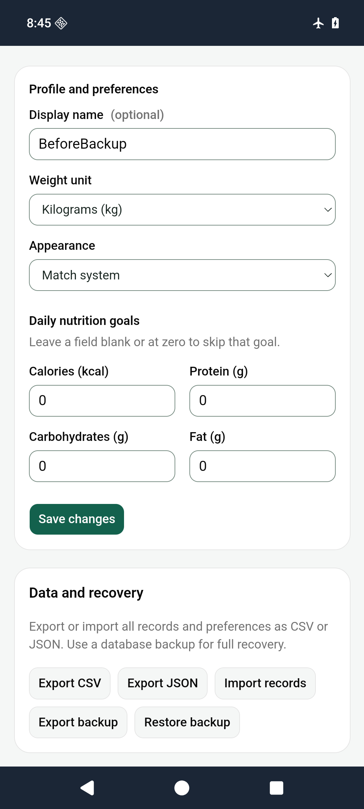

## Added

- FitTrack is available as an Android APK for ARM64 and x86-64 devices running Android 8 or later.
- Android Settings can export and restore SQLite backups using the system document picker. FitTrack validates the selected backup and saves a recovery snapshot before replacing existing data. Compatible desktop and Android versions can share backups.

## Changed

- FitTrack keeps Android data in private app storage, disables automatic cloud backup for that data, and runs without internet permission.
- Fixed the Android SDK setup, Wails build dependencies, and template preparation used by the release workflow.

## Android screenshots

| Exercise library | Backup and recovery |
| --- | --- |
|  |  |
